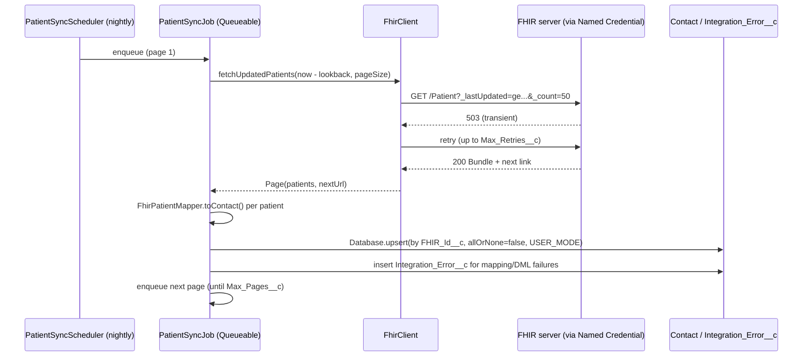

# FHIR Patient Sync for Salesforce

Scheduled Apex integration that pulls changed **FHIR R4 Patient** resources from a FHIR server and
upserts them into Salesforce Contacts by external Id, with retries for transient failures and an
`Integration_Error__c` log written in plain language so support can triage without a developer.

> **Representative portfolio project.** I have built EHR-to-Salesforce demographic syncs through
> REST and HL7/FHIR-based middleware for a healthcare client. This repository is an independent,
> clean-room implementation written from scratch, tested only against **synthetic data** and the
> public HAPI FHIR test server. It contains no client code, endpoints, credentials, mappings or PHI.

## Business problem

Front-desk and care teams need patient demographics in Salesforce to match the EHR. Manual
re-keying causes typos and duplicates; a brittle integration that fails silently is worse. The sync
has to be idempotent, survive rate limits and server hiccups, and tell support exactly which record
failed and why.

## How it works



| Component | Responsibility |
|---|---|
| `FhirClient` | Callouts through the `FHIR_Server` Named Credential; retries 429/5xx; parses Bundle and `next` link; re-bases `next` links on the Named Credential so a tampered link cannot redirect the callout. |
| `FhirPatientMapper` | Pure mapping from FHIR Patient JSON to Contact (official/usual name preference, birth date, phone, email, address, lastUpdated). Rejects records without a family name with a readable reason. |
| `PatientSyncJob` | One page per Queueable transaction, upsert by `FHIR_Id__c`, partial-success handling, error logging, chaining. |
| `PatientSyncScheduler` | Nightly entry point. |
| `FHIR_Sync_Setting__mdt` | Page size, retries, max pages per run, lookback window, changeable without deployment. |

**Why Queueable chaining rather than `Database.Batchable`?** The source is a paged REST API, not a
SOQL result set. Each page gets its own transaction and callout limits, and the next page is
enqueued only after the current one commits.

## Setup

Prerequisites: Salesforce CLI, a Dev Hub (free Developer Edition works), Node.js 20+.

```bash
git clone https://github.com/arifkhanshaukat-bot/fhir-patient-sync-salesforce.git
cd fhir-patient-sync-salesforce
sf org create scratch --definition-file config/project-scratch-def.json --alias fhir --set-default
sf project deploy start
sf org assign permset --name FHIR_Sync_Integration
```

The included `FHIR_Server` Named Credential points to the public HAPI FHIR R4 test server, which
holds only test data. For a real server, replace it with a Named Credential backed by an External
Credential (OAuth 2.0 client credentials or JWT). Never put secrets in code or in this repository.

Run once now, or schedule nightly (Execute Anonymous):

```apex
System.enqueueJob(new PatientSyncJob());
System.schedule('FHIR patient sync', '0 0 2 * * ?', new PatientSyncScheduler());
```

Review failures in the **Integration Errors** tab (list view or report on `Integration_Error__c`).

## Tests

```bash
sf apex run test --test-level RunLocalTests --code-coverage --result-format human
```

| Test class | Covers |
|---|---|
| `FhirClient_Test` | Bundle parsing, `_lastUpdated` filter, retry on 503/429, give-up after max retries, no retry on 4xx, next-link re-basing and rejection |
| `FhirPatientMapper_Test` | Full mapping, name preference, partial dates, missing id/family name |
| `PatientSyncJob_Test` | End-to-end page sync with one bad record, idempotent upsert, callout failure logging, scheduler |

All HTTP traffic in tests is mocked (`FhirMock`) using the synthetic bundle in
`staticresources/FhirSampleBundle.resource`.

## Security and privacy

- Callouts only through a Named Credential; no endpoints, tokens or keys in code.
- Upserts use `AccessLevel.USER_MODE`; assign `FHIR_Sync_Integration` to a dedicated integration user.
- Error payloads can contain demographics. In a real deployment, restrict `Integration_Error__c`
  with a private sharing model, mask or omit payloads, and add a retention purge.
- Synthetic test data only; do not sync real PHI into scratch or developer orgs.

## Limitations and next steps

- Patient resource only; Encounter sync and duplicate matching (beyond external Id) are not included.
- Retries are immediate within a transaction (Apex has no sleep); a delayed retry via a scheduled
  re-queue of failed pages is a planned enhancement.
- Planned: Health Cloud `Account`/`PersonAccount` target option, Code Analyzer in CI.

## License

MIT, see [LICENSE](LICENSE).
